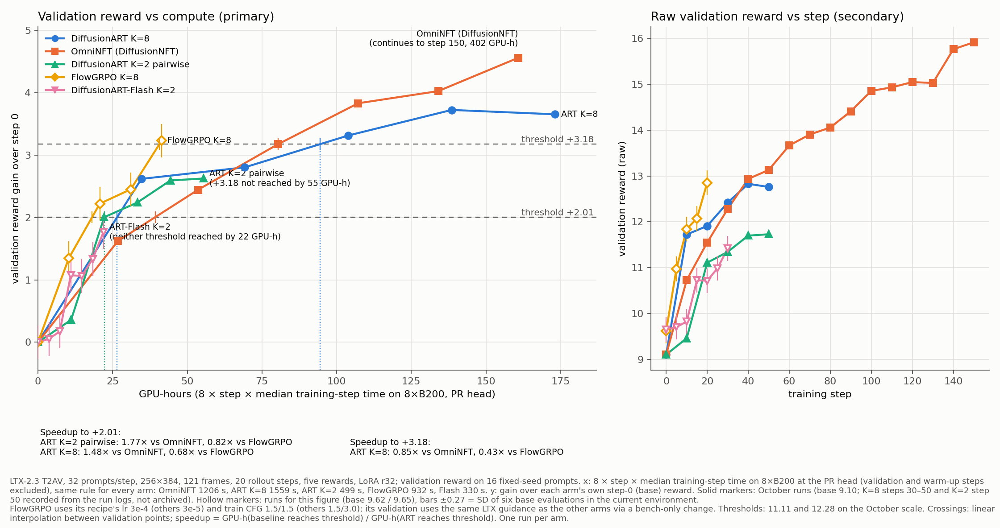

# Reward vs GPU-hours (LTX-2.3 T2AV)



- `reward_vs_gpu_hours.png`: left, gain in validation reward over step 0 against GPU-hours (primary); right, raw validation reward against step.
- `reward_vs_gpu_hours.csv`: one row per point, with raw reward, gain, noise SD and source.
- `reward_vs_gpu_hours.json`: the same points plus step times, thresholds, crossings and speedups.
- `make_reward_vs_gpuh.py` and `caption.txt` reproduce the figure. Run it from this directory:

  ```bash
  python make_reward_vs_gpuh.py --metrics ../metrics.json \
    --step-time 'OmniNFT (DiffusionNFT)=1206.1' --step-time 'DiffusionART K=8=1558.5' --step-time 'DiffusionART K=2 pairwise=499.1' \
    --curve-log 'FlowGRPO K=8=logs/flowgrpo_k8_20steps.log' --curve-log 'DiffusionART-Flash K=2=logs/art_flash_k2_30steps.log' \
    --noise 0.27 --relative --caption caption.txt --out .
  ```

- `logs/`: metric lines (`step:N - …` and the initial validation) from the runs made for this figure, all on 8×B200 at the PR head:
  - the FlowGRPO (20 steps) and DiffusionART-Flash (30 steps) training runs;
  - the timing runs of OmniNFT (4 steps), DiffusionART K=8 (3 steps) and DiffusionART K=2 (4 steps, 2026-11-04).

**Definitions**
- **GPU-hours:** 8 × step × median training-step time on 8×B200 at the PR head. Validation steps and step 1 are excluded, and the rule is the same for every arm.
- **Reward vs step:** OmniNFT, DiffusionART K=8 and K=2 come from the October runs in `../metrics.json`. The validation rewards for K=8 steps 30–50 and K=2 step 50 were recorded from the run logs and are not in that file.
- **Gain:** validation reward minus the arm's own step-0 value. The base differs between the October environment (9.10) and the current one (9.62 / 9.65 for the two new runs; SD 0.27 over six base evaluations).
- **Thresholds:** 11.11 and 12.28 on the October scale, i.e. +2.01 and +3.18.
- **Speedup:** GPU-hours(baseline reaches the threshold) / GPU-hours(ART reaches it), with crossings linearly interpolated between validation points.
