# MiniMax-H3 T2VA, five-reward set: DiffusionART step 0 · 10 · 20 · 30 · 40 (same prompt and seed per row set)

Validation reward over 128 prompts: 9.63 → 12.45 → 12.68 → 13.20 → 13.82 (paired 30→40 Δ +.62 ± .11, 94/128 up). Components at
0/10/20/30/40: VideoAlign 1.22/1.31/1.37/1.43/1.43 (flat since 30), HPSv3 6.71/9.29/9.35/9.76/10.31, AudioBox .387/.407/.433/.441/.465,
CLAP .582/.605/.616/.618/.624, DeSync .730/.839/.909/.949/.989 (30→40 up on only 24/128 clips).
Pixel statistics on these 16 clips vs step 0 at step 40: luma ×1.64, contrast ×1.31, saturation ×0.80, **sharpness ×6.40 (16/16 up)**,
motion ×0.63. Between 30 and 40 brightness and desaturation partly reverted (luma ×0.88, saturation ×1.30) while sharpness kept
climbing (×1.29) — the only monotone drift is over-sharpening; motion has sat at ≈ 0.6× base since step 10.

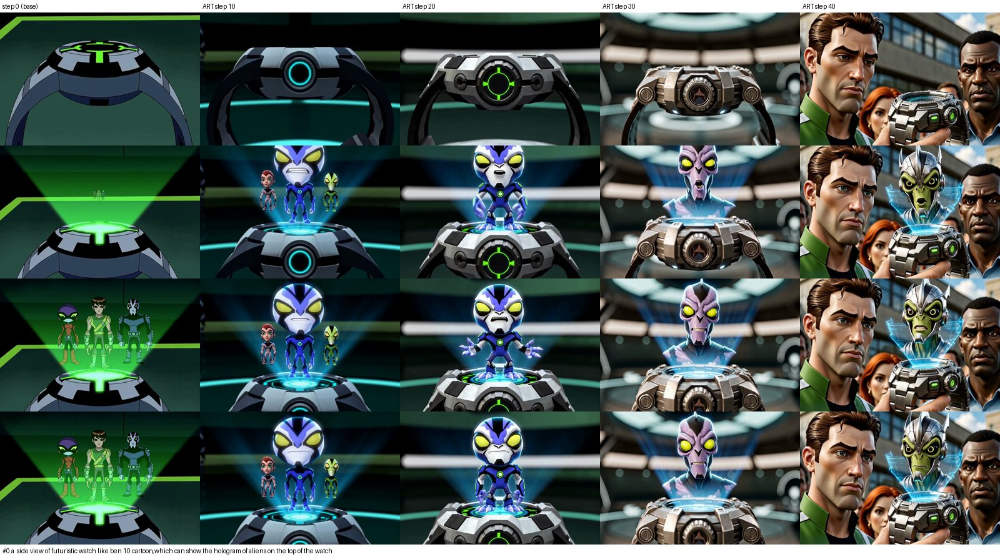

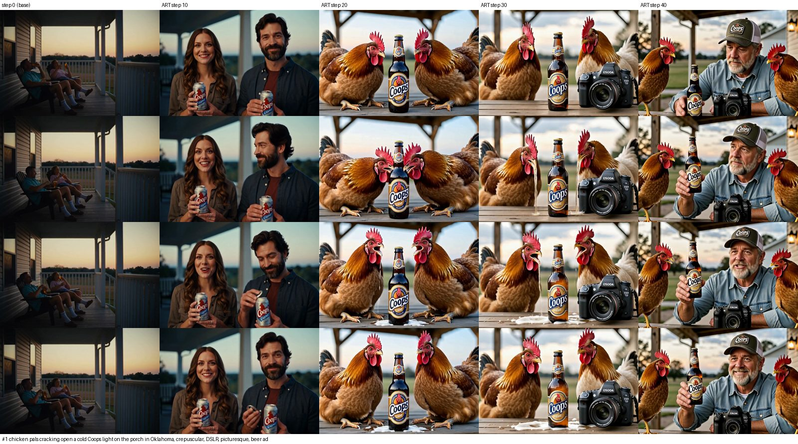

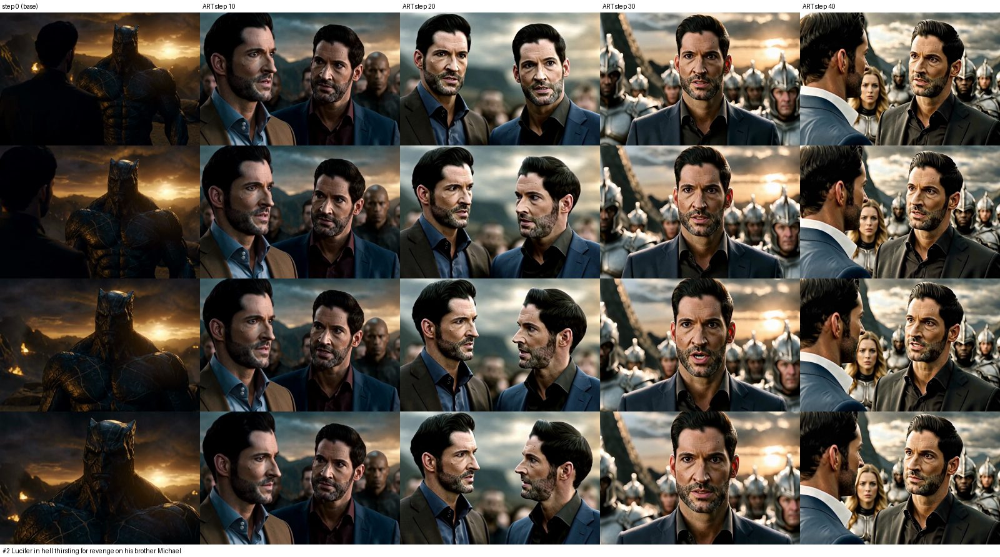

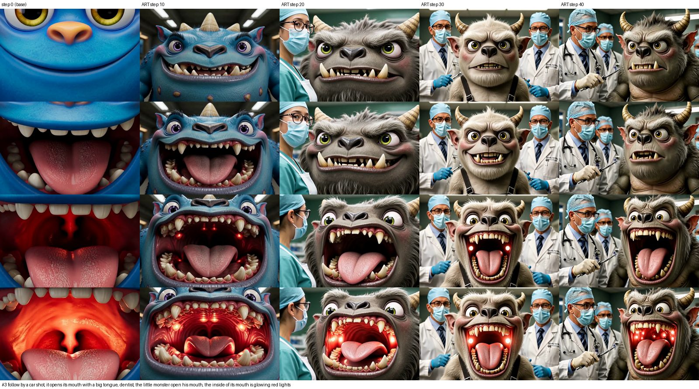

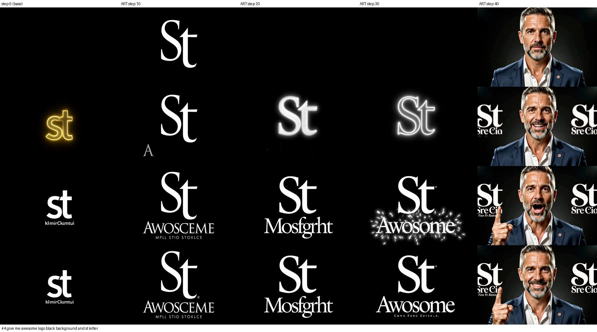

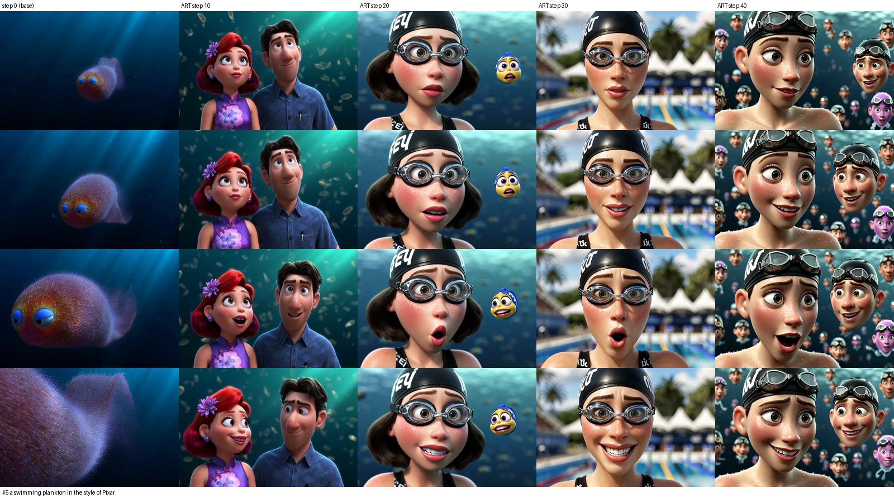

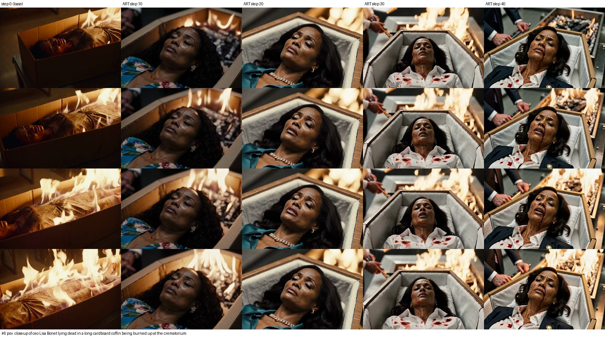

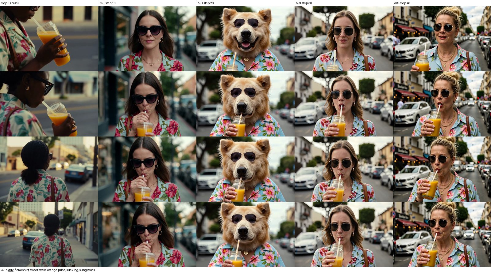

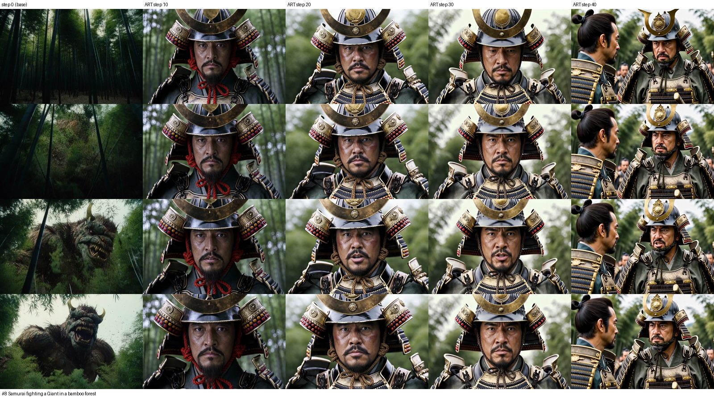

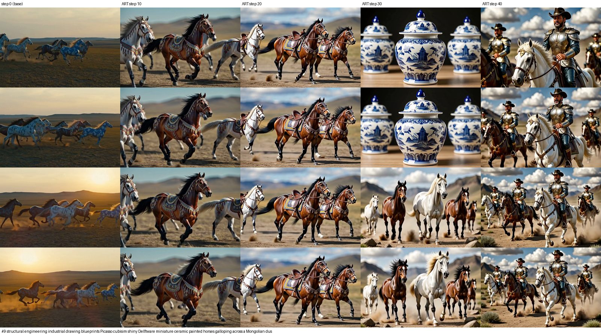

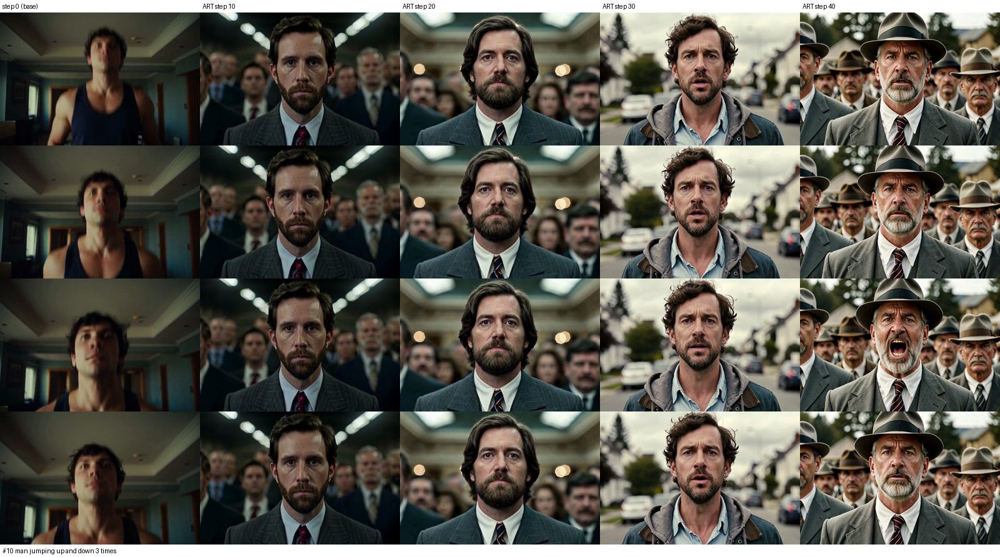

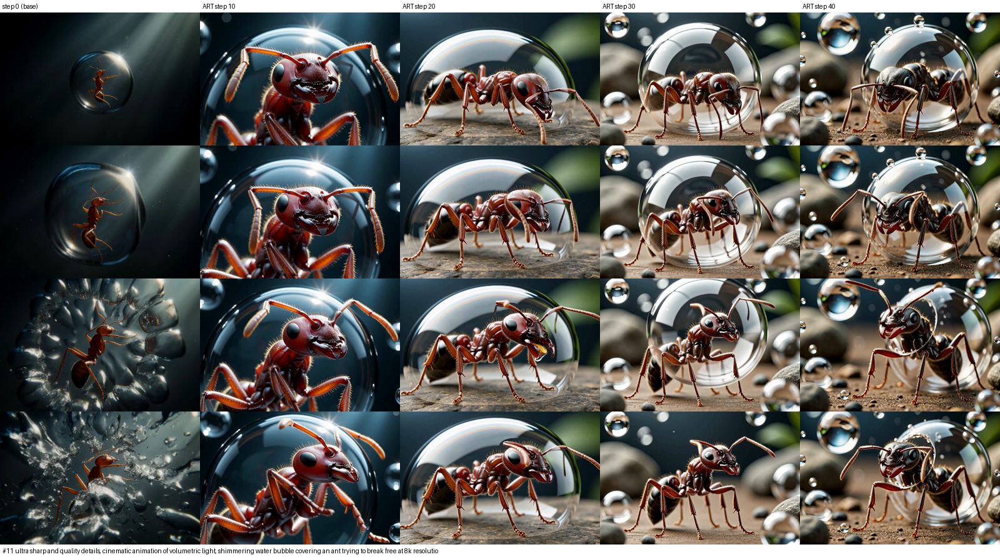

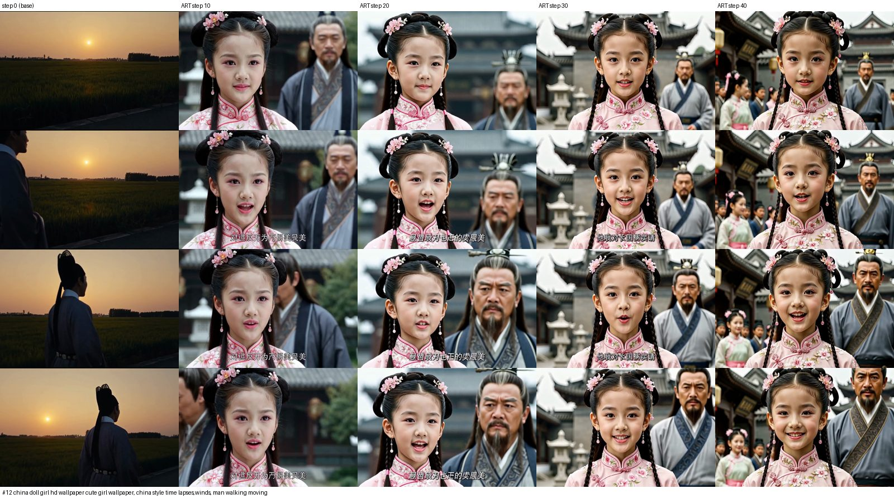

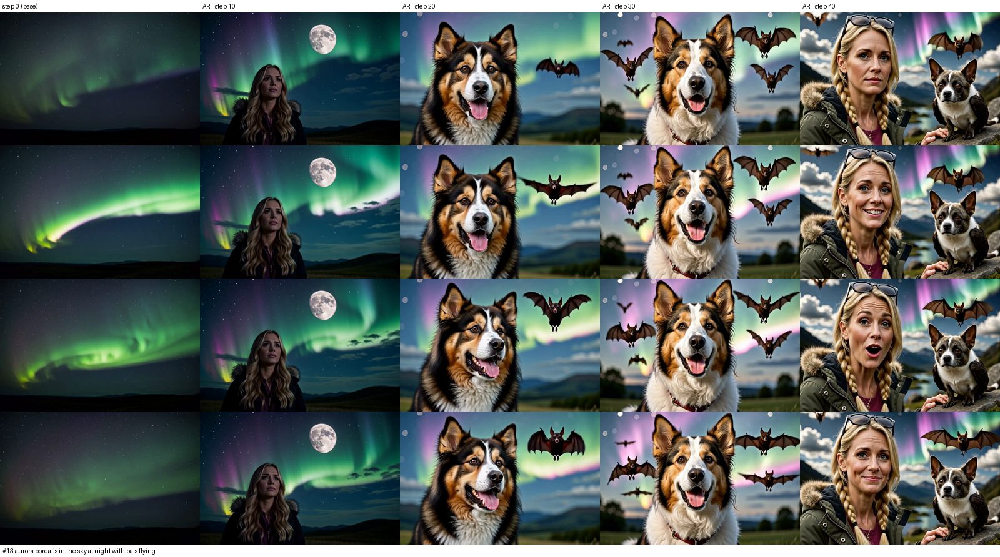

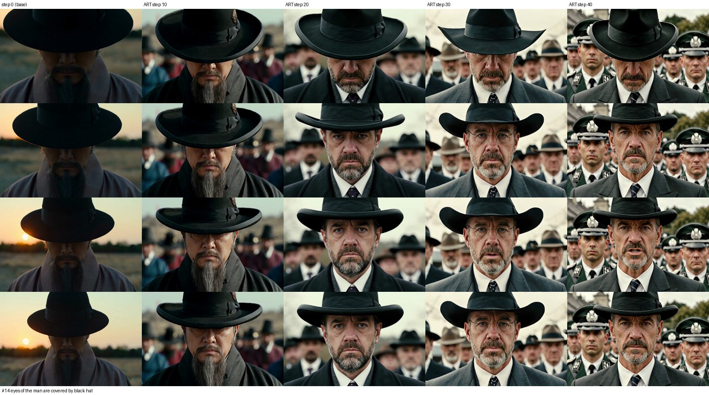

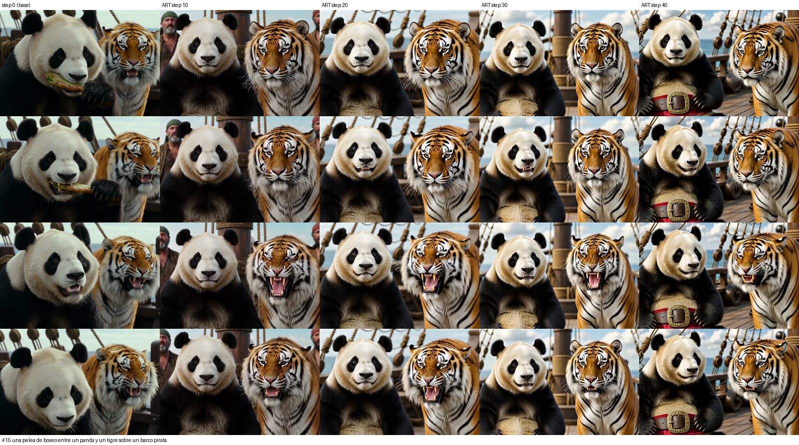

