# MiniMax-H3 T2VA, five-reward set: DiffusionART step 0 · 10 · 20 · 30 · 40 · 50 (same prompt and seed per row set)

Validation reward over 128 prompts: 9.63 → 12.45 → 12.68 → 13.20 → 13.82 → 14.01 (40→50 paired Δ +.19 ± .12, 66/128 up).
Components at 0/…/50: **VideoAlign 1.22/1.31/1.37/1.43/1.43/1.36 (40→50: −.077 ± .021, up on only 46/128)**, HPSv3
6.71/9.29/9.35/9.76/10.31/10.55, AudioBox .387/.407/.433/.441/.465/.490, CLAP .582/.605/.616/.618/.624/.622, DeSync
.730/.839/.909/.949/.989/.992 (40→50 up on 5/128). The sum still rises because HPSv3 and AudioBox do; the video-quality scorer
has turned down.
Pixel statistics on these 16 clips vs step 0 at step 50: luma ×1.74, contrast ×1.37, saturation ×0.85, **sharpness ×6.55 (16/16),
motion ×0.42 (40→50 alone ×0.66, 1/16 up), first−last frame difference ×0.67** — the clips are becoming near-static again.

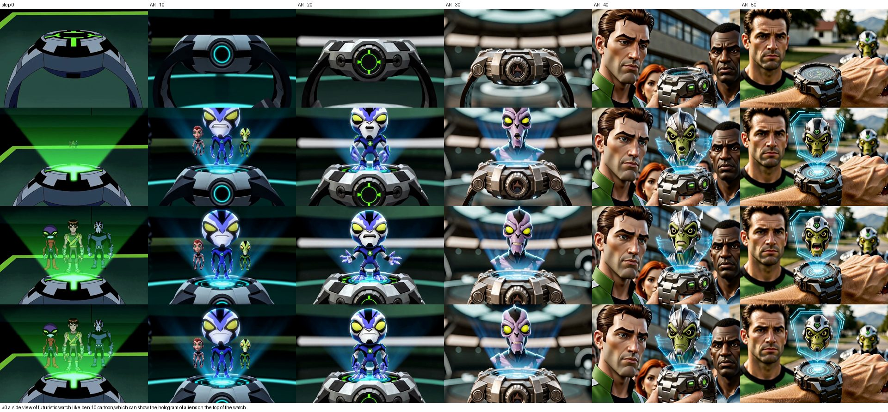

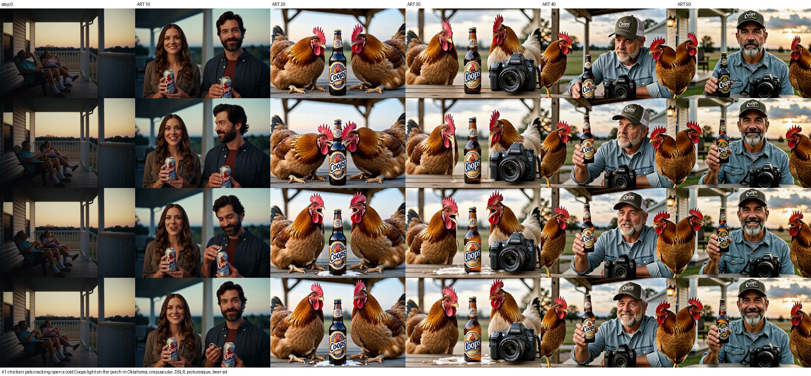

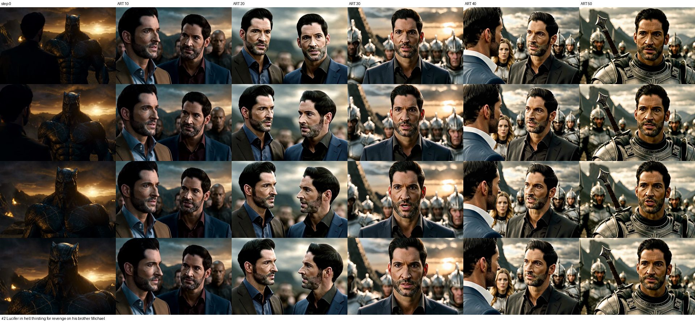

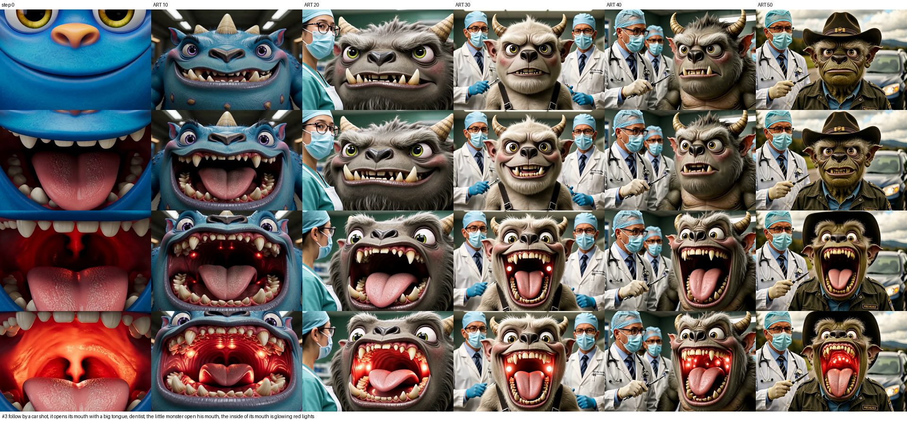

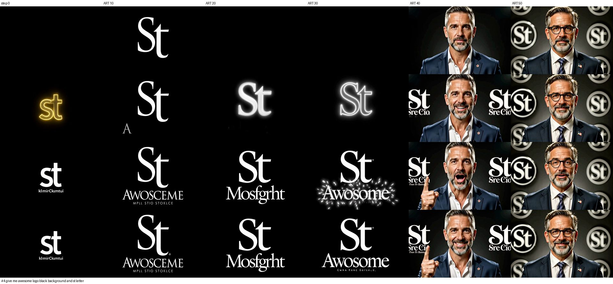

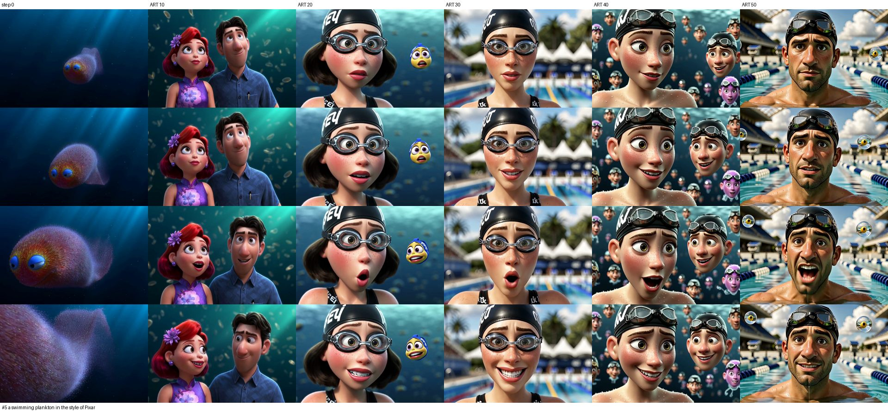

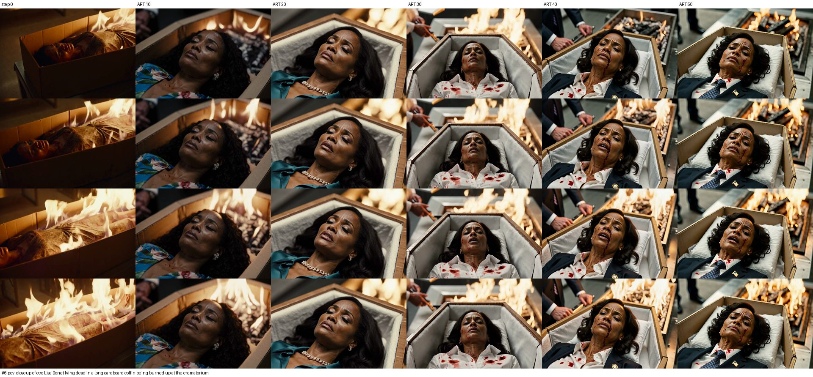

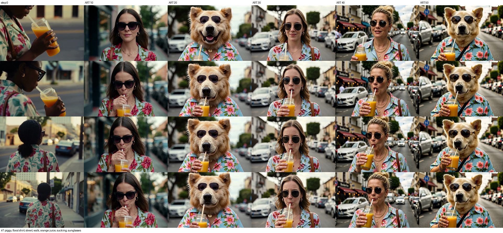

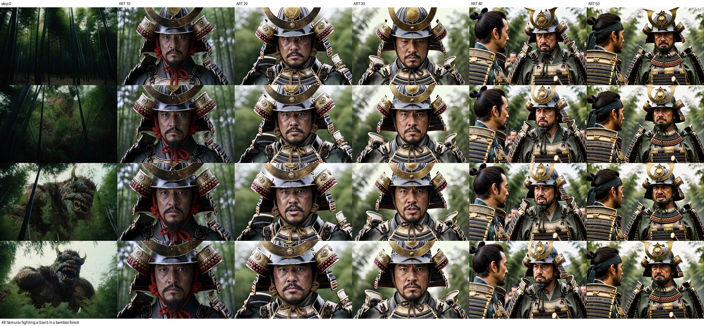

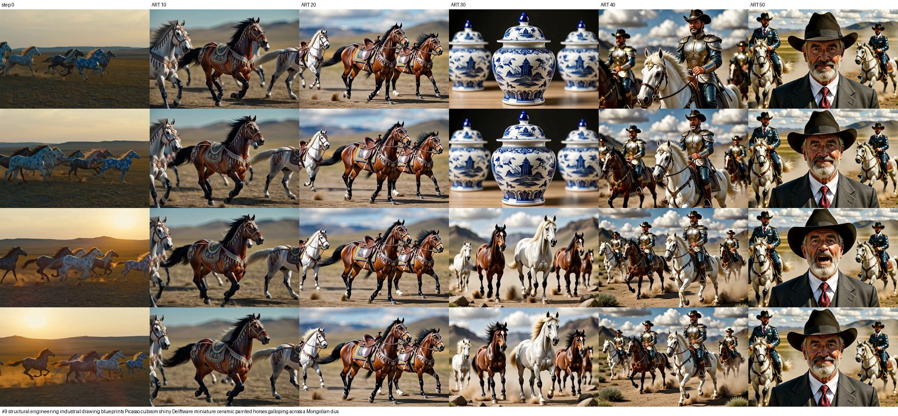

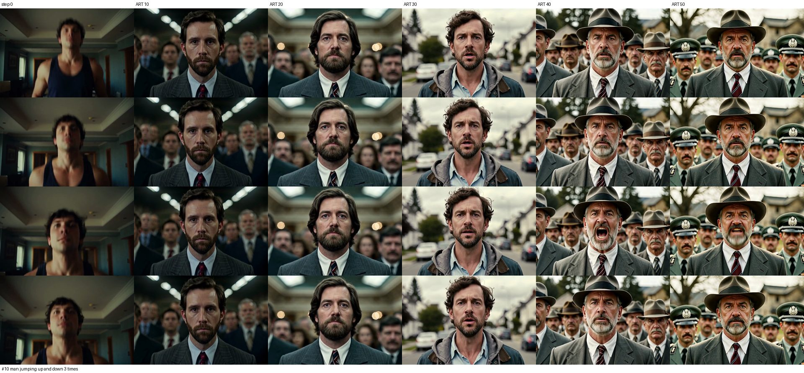

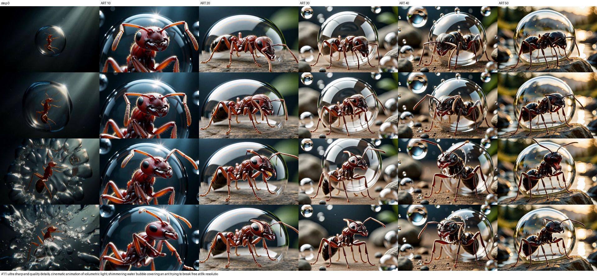

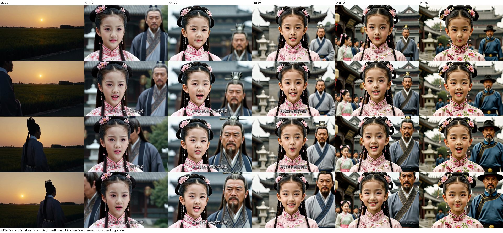

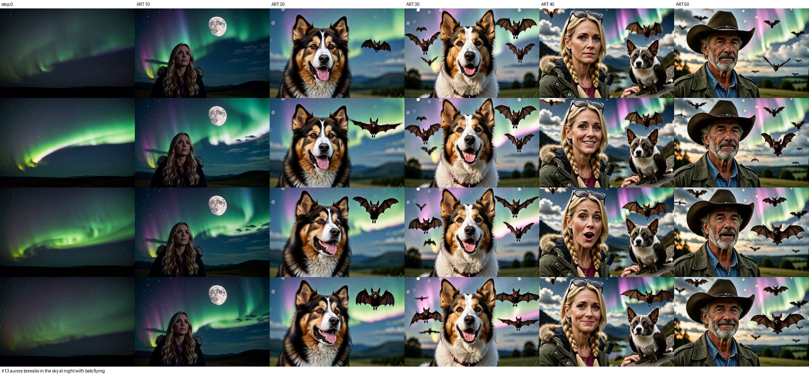

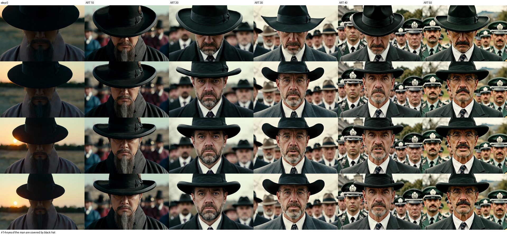

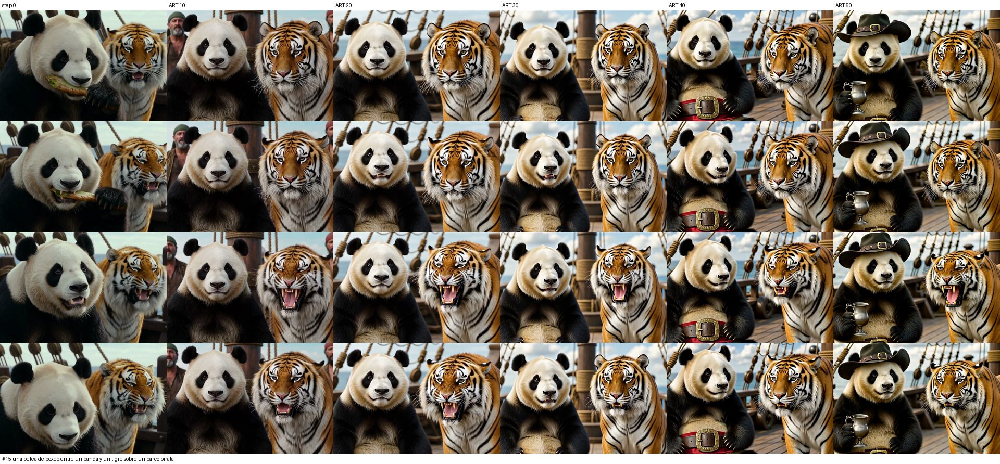

