# MiniMax-H3 T2VA, five-reward set: DiffusionART step 0 · 20 · 40 · 50 · 60 (final), same prompt and seed per row set

Run finished at step 60 (G=8, 32 prompts/step, 8×B200, ≈870 s/step). Validation reward over 128 fixed-seed prompts:
9.63 → 12.45 → 12.68 → 13.20 → 13.82 → 14.01 → **14.25** at steps 0/10/20/30/40/50/60 (50→60 paired Δ +.24 ± .11, 70/128 up; 0→60 up on 123/128).
Components at 0 → 60: VideoAlign 1.22 → 1.37 (peak 1.43 at steps 30–40, dip to 1.36 at 50, +.019 ± .019 at 60 — flat since step 30),
HPSv3 6.71 → 10.75, AudioBox .387 → .507 (up on 105/128 for 50→60), CLAP .582 → .632, DeSync .730 → .988.
Pixel statistics on these 16 clips, step 60 vs step 0: **sharpness ×6.6 (16/16), luma ×1.64, contrast ×1.36, saturation ×0.95, motion ×0.49,
first−last frame difference ×0.77**; step 50→60: motion ×1.16 (13/16 up), saturation ×1.12, sharpness ×1.01 — the step-50 freeze did not deepen.
Reading: the sum keeps rising on HPSv3 and AudioBox; the video-quality scorer has been flat for 30 steps while the clips became much sharper and
about half as dynamic as the base model's. No paired DiffusionNFT arm (its node was stopped), so this is not yet an ART-vs-NFT statement.

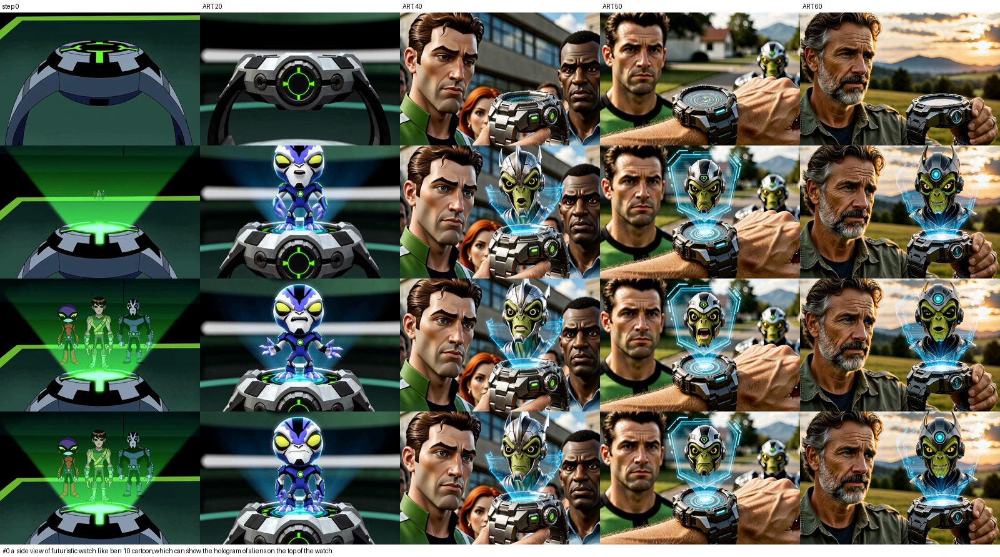

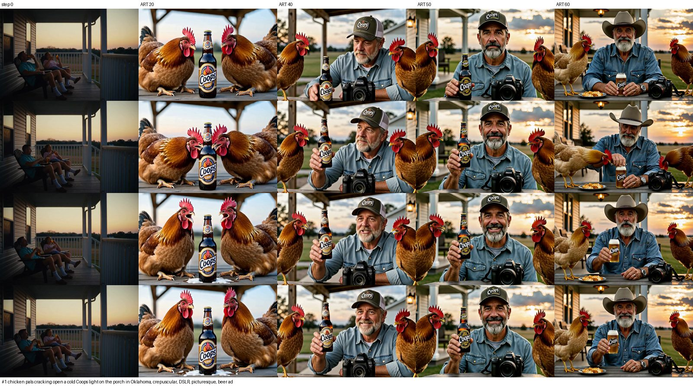

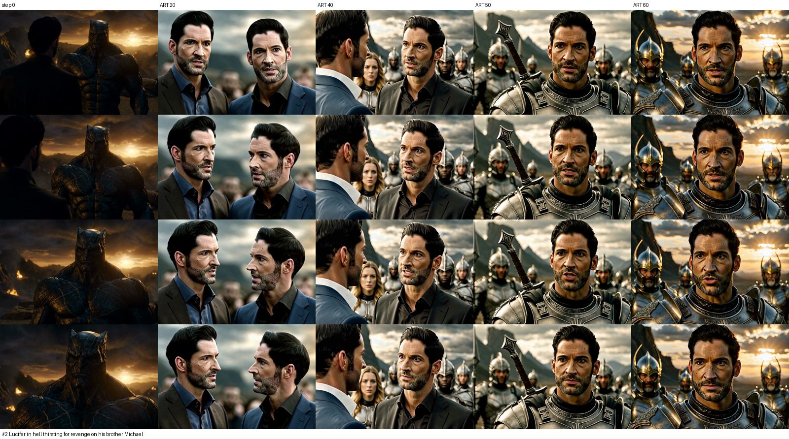

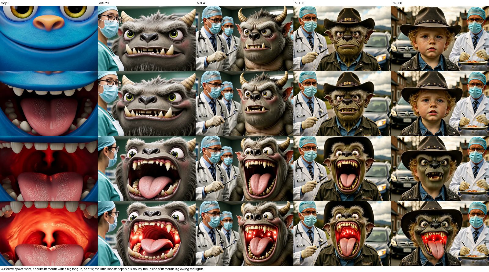

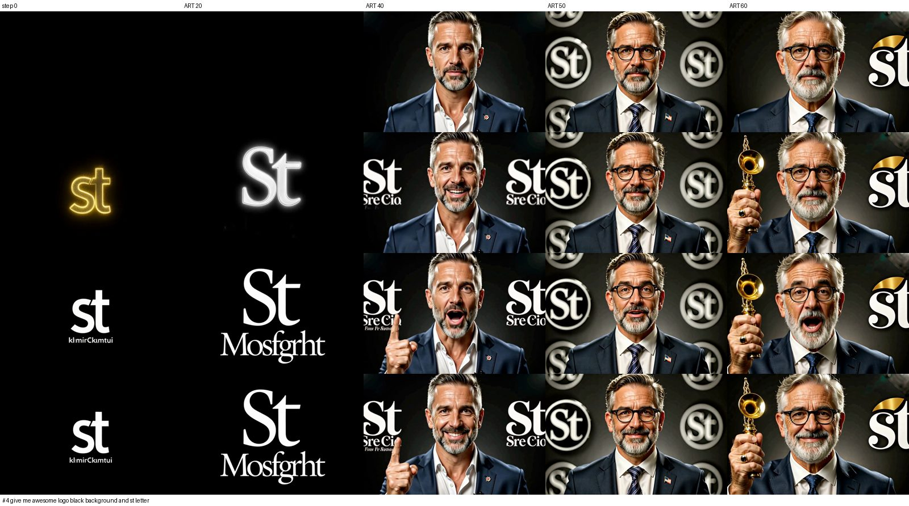

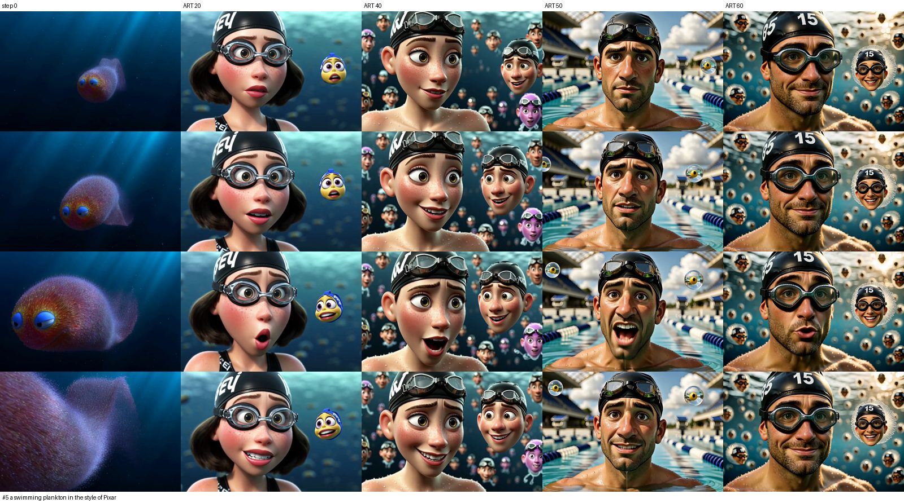

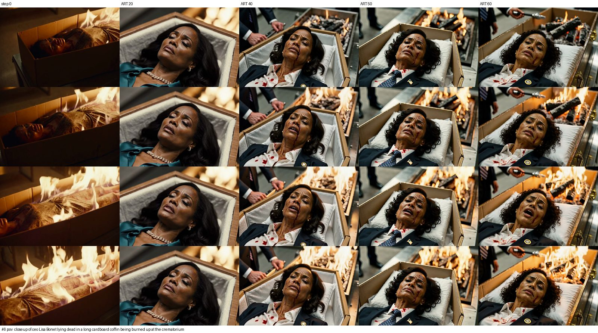

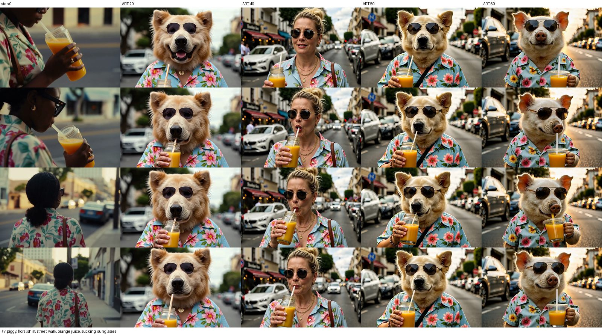

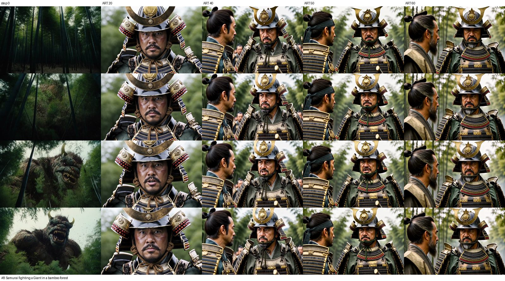

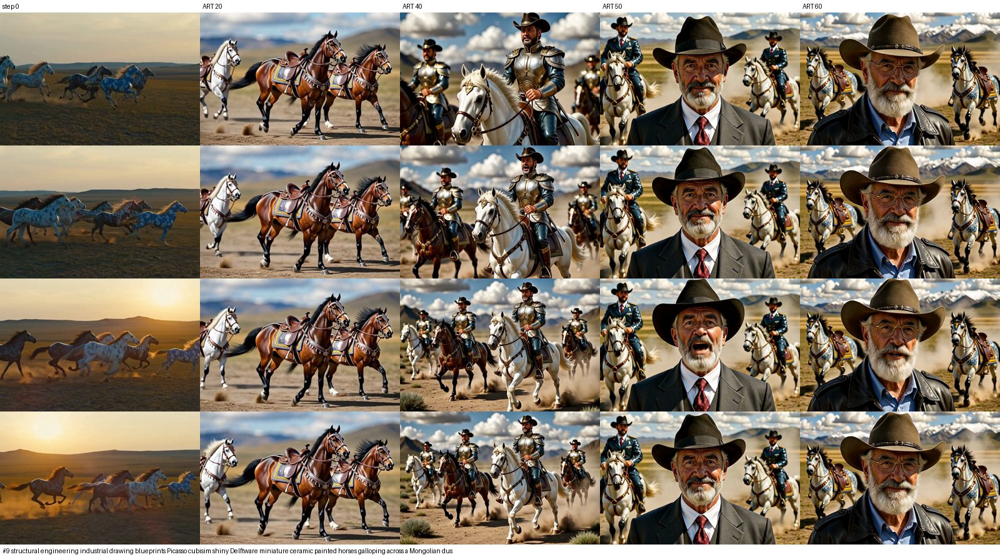

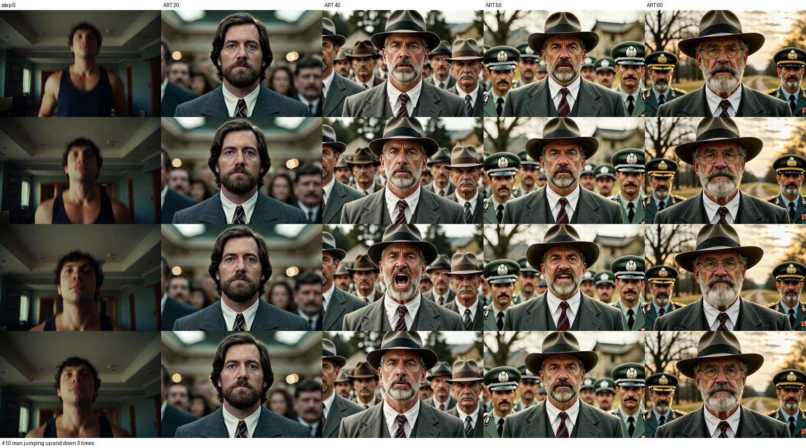

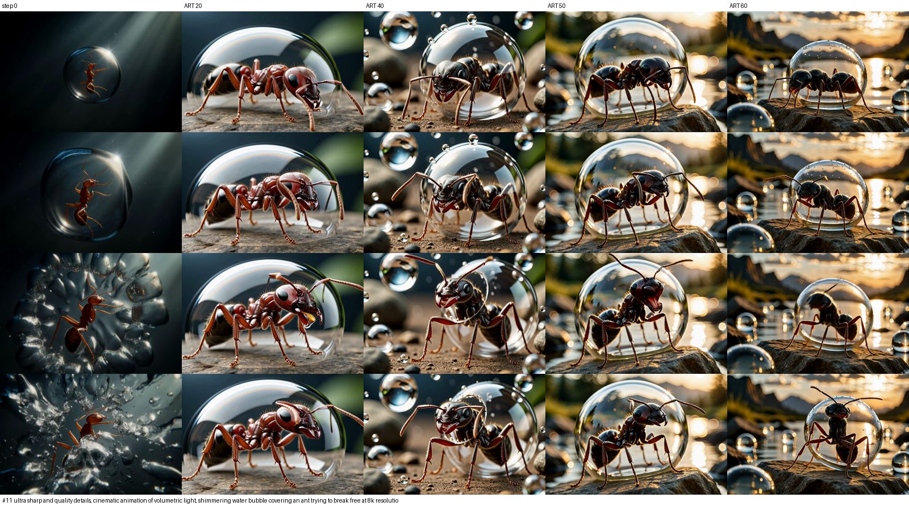

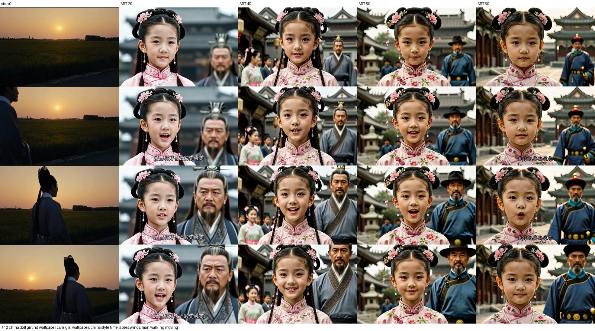

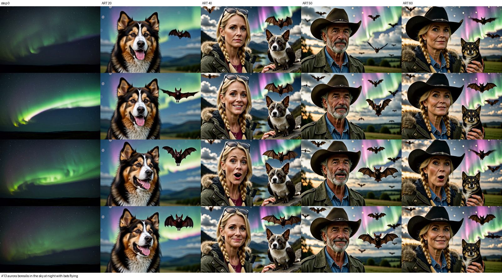

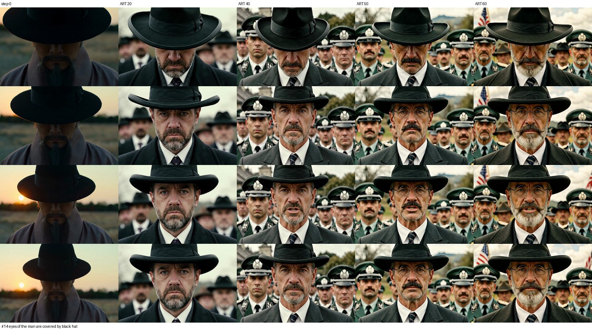

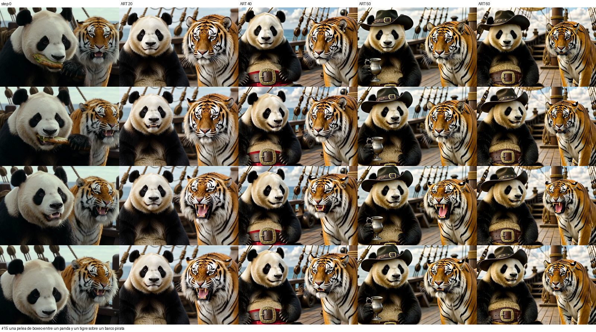

