# MiniMax-H3 T2VA with the five-reward set (VideoAlign 1.0, HPSv3 1.5, AudioBox .5, CLAP 1.0, DeSync 1.0): DiffusionART step 0 vs step 10

Validation prompts 0–15 (README VidProM test split), same seed per row set, 512×768×121f, 40 steps. Frames at 0 %, 33 %, 67 %, 100 %.
Validation reward over 128 prompts: 9.63 → 12.45 (paired Δ +2.83 ± .23 SE, 117/128 up); per component VideoAlign 1.22 → 1.31,
HPSv3 6.71 → 9.29, AudioBox .387 → .407, CLAP .582 → .605, DeSync .730 → .839. Pixel statistics on these 16 clips vs step 0:
luma ×1.07, contrast ×1.04, **sharpness ×2.54**, saturation ×0.93, **motion ×0.68**. No dark/frozen collapse as with CLAP + ImageBind;
the trade is the LTX one (sharper, stiller), reached by step 10.

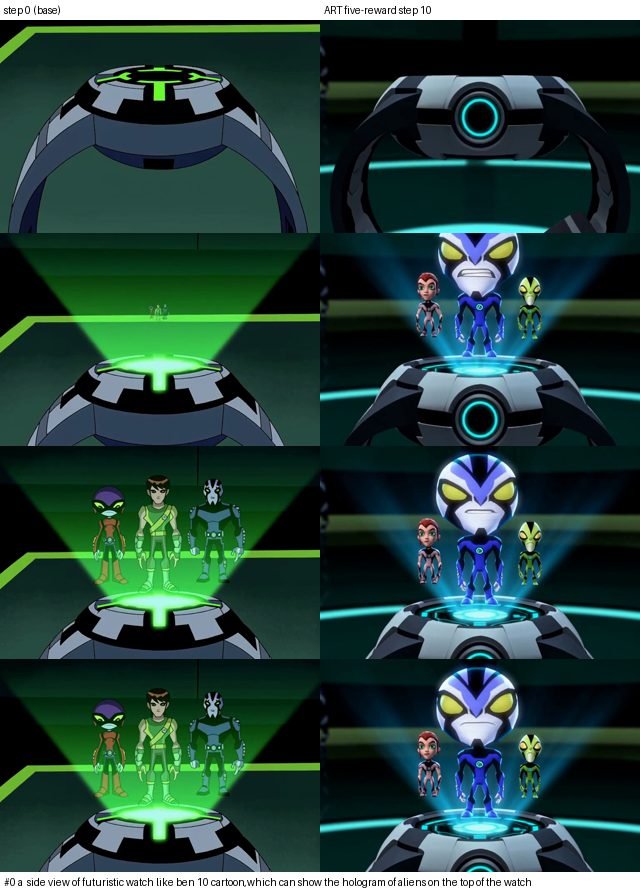

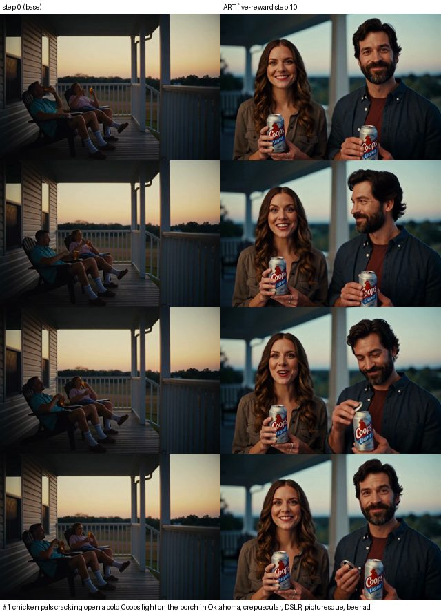

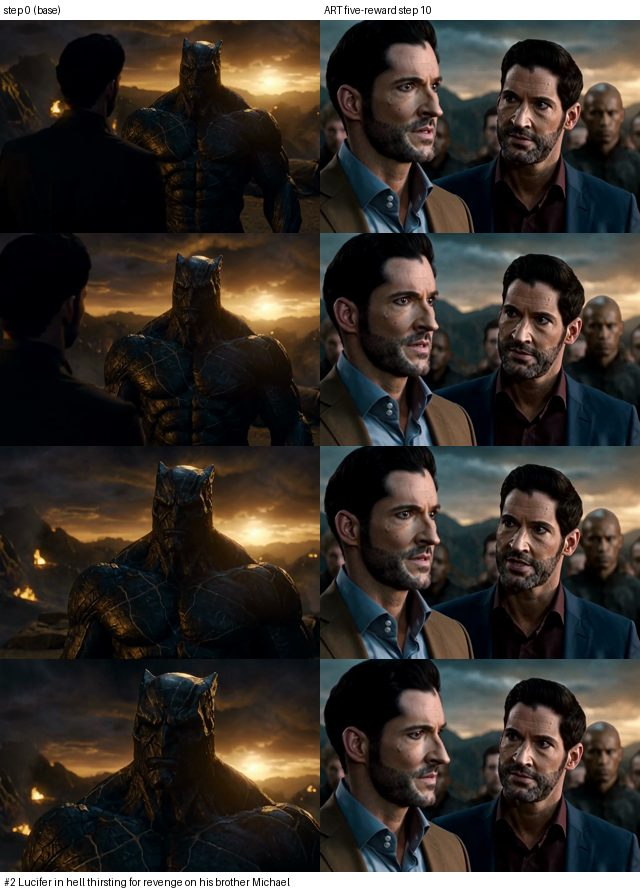

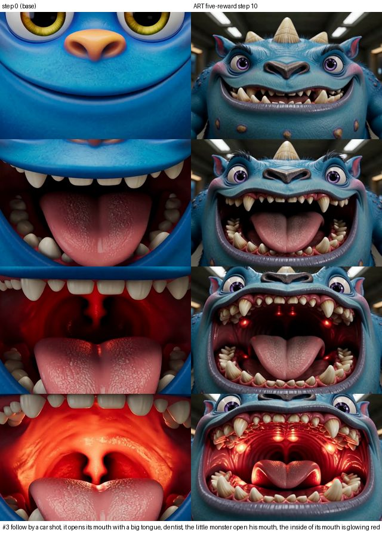

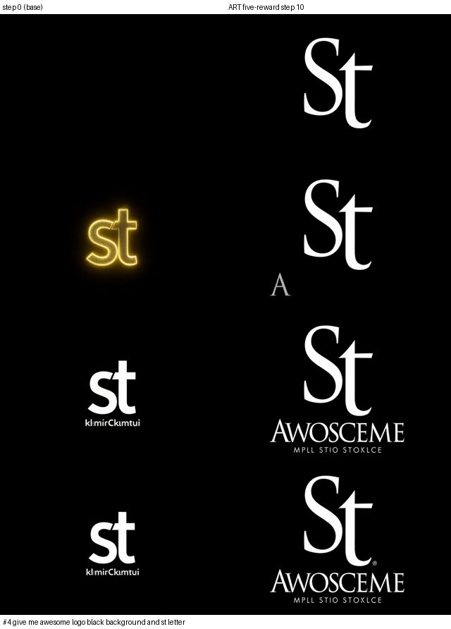

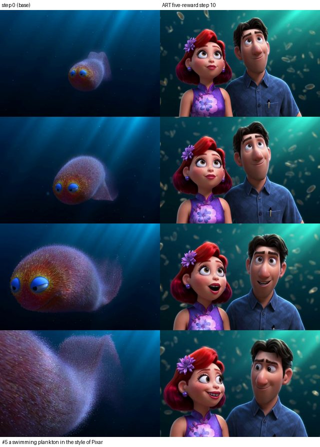

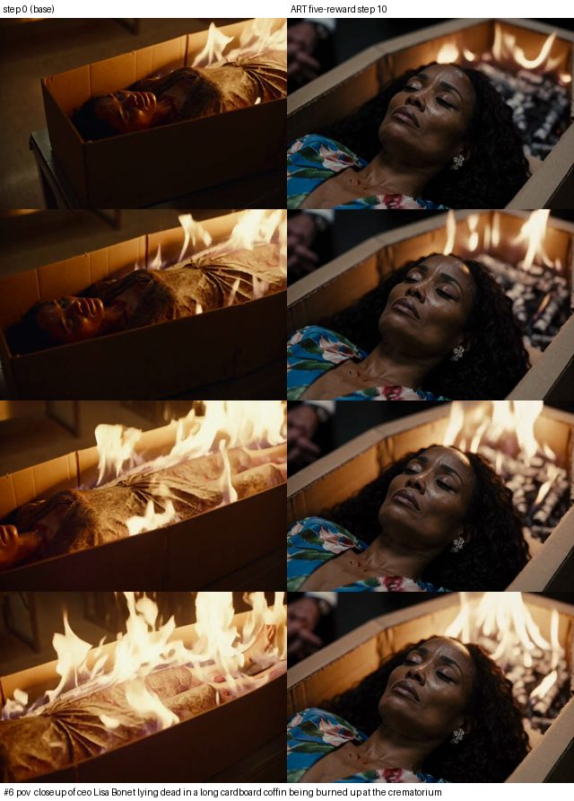

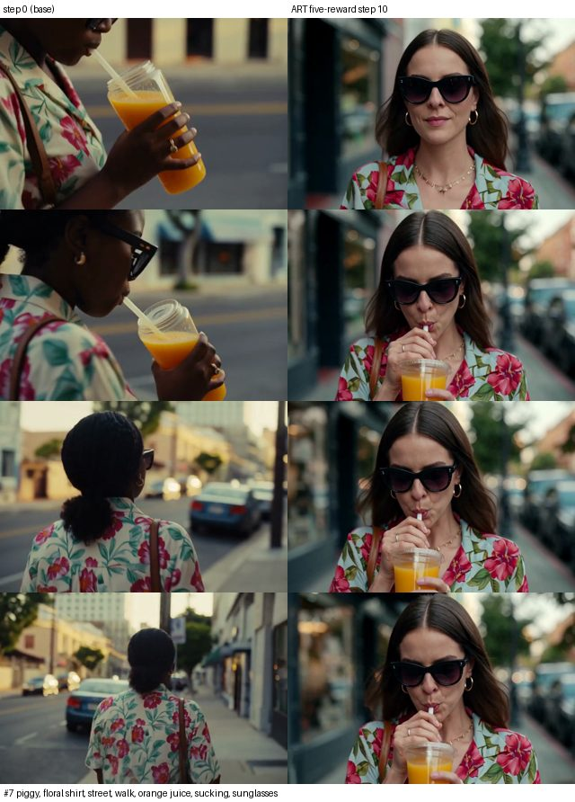

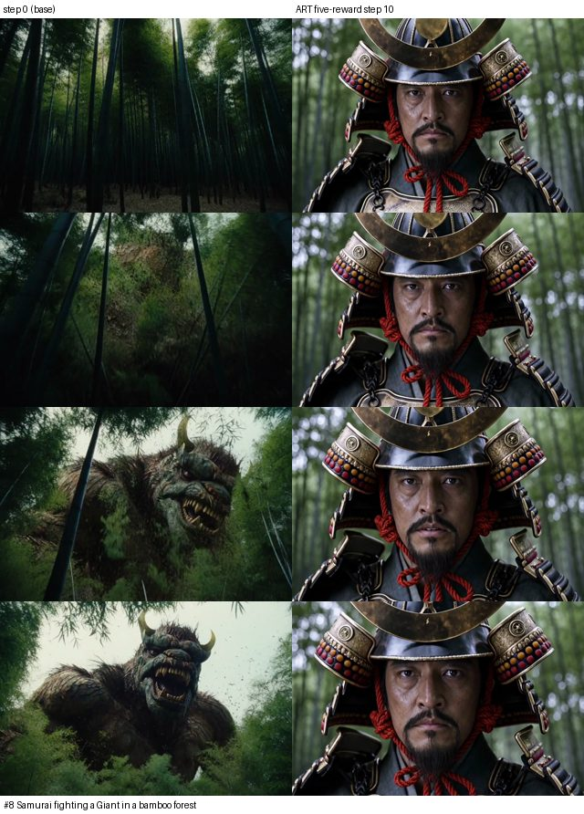

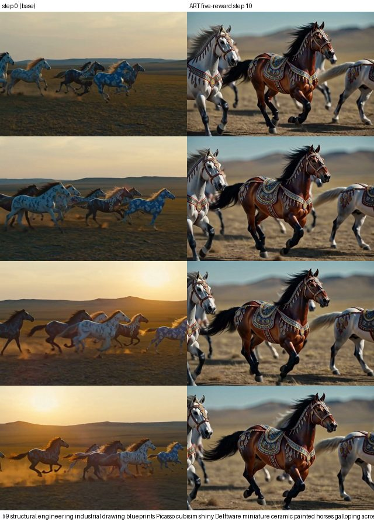

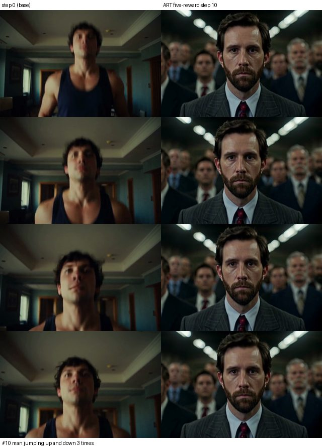

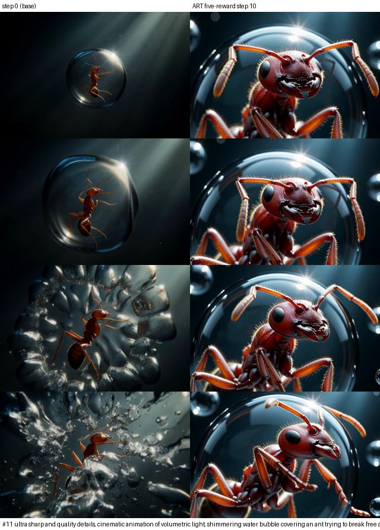

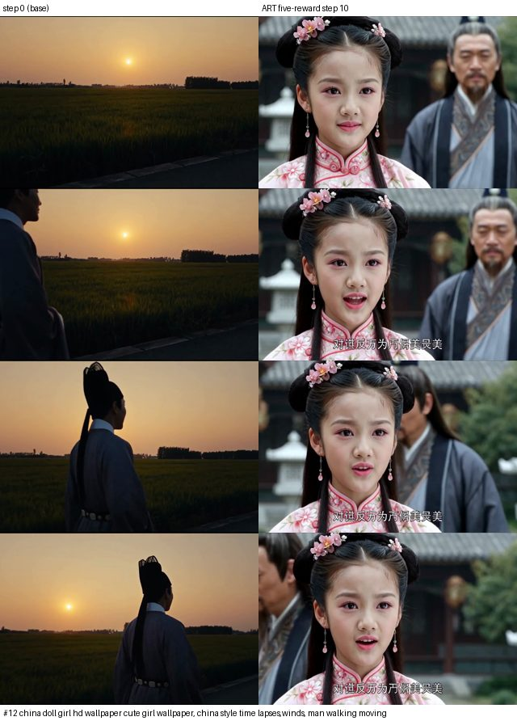

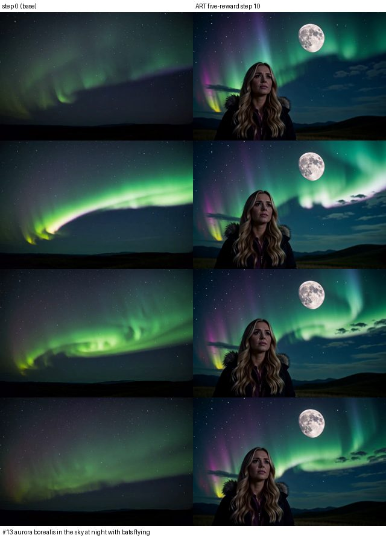

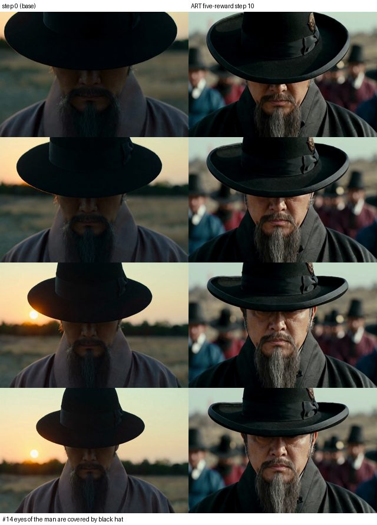

